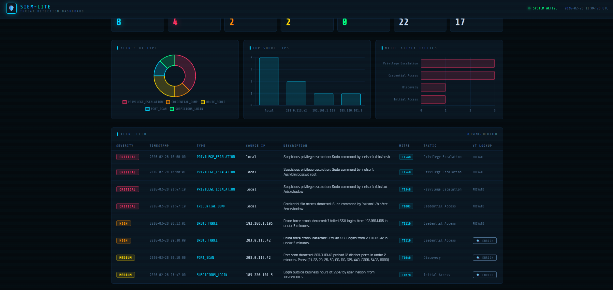
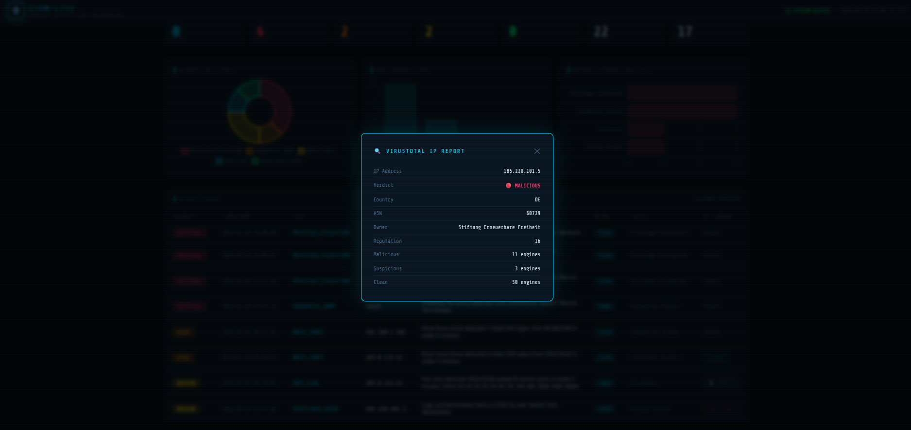
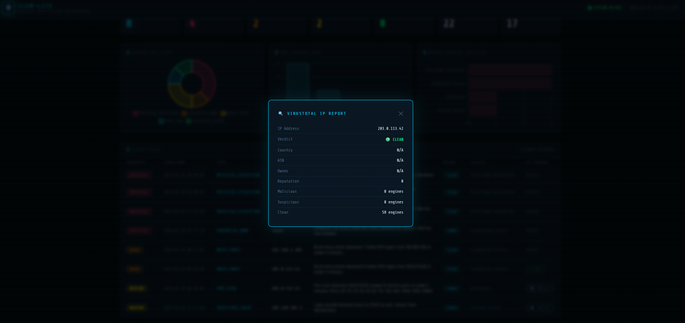

# 🛡️ SIEM-Lite — Security Information & Event Management System

[](https://www.python.org/)
[](https://flask.palletsprojects.com/)
[](https://pandas.pydata.org/)
[](https://attack.mitre.org/)
[](https://www.virustotal.com/)
[](https://opensource.org/licenses/MIT)

**SIEM-Lite** is a lightweight, high-performance Security Information and Event Management (SIEM) system built in Python. It ingests Linux authentication (`auth.log`) and firewall (`ufw.log`) logs, applies rule-based correlation engines mapped directly to the **MITRE ATT&CK® framework**, and provides an interactive real-time SOC analyst dashboard with on-demand **VirusTotal IP threat intelligence enrichment**.

---

## 📑 Table of Contents

- [Overview](#-overview)
- [Key Features](#-key-features)
- [Screenshots](#-screenshots)
- [Detection Engine & MITRE ATT&CK Matrix](#-detection-engine--mitre-attck-matrix)
- [Architecture & Data Pipeline](#-architecture--data-pipeline)
- [Tech Stack](#-tech-stack)
- [Project Structure](#-project-structure)
- [Getting Started](#-getting-started)
  - [Prerequisites](#prerequisites)
  - [Installation](#installation)
  - [Environment Configuration](#environment-configuration)
  - [Running the Application](#running-the-application)
- [CLI Verification](#-cli-verification)
- [How It Works](#-how-it-works)
- [Threat Intelligence (VirusTotal)](#-threat-intelligence-virustotal)
- [Configuration & Rule Tuning](#-configuration--rule-tuning)
- [Roadmap](#-roadmap)
- [License](#-license)

---

## 🌟 Overview

Modern Security Operations Centers (SOC) require rapid correlation, anomaly detection, and actionable threat intelligence. **SIEM-Lite** mirrors enterprise SOC workflows in an accessible, dependency-light package:

1. **Normalized Ingestion:** Ingests heterogeneous system logs (SSH authentication, sudo audit logs, and UFW firewall events) into standardized pandas schemas.
2. **Context-Aware Correlation:** Evaluates time-windowed security thresholds (e.g., sliding-window brute force, multi-port probing).
3. **MITRE ATT&CK Alignment:** Tags every generated alert with industry-standard Tactics, Techniques, and Procedures (TTPs).
4. **Interactive Analyst Dashboard:** Fast, responsive UI with real-time severity metrics, distribution graphs, and sortable event feeds.
5. **Threat Intelligence Enrichment:** Seamlessly integrates with VirusTotal API v3 to identify malicious external actors, Tor exit nodes, and known threat infrastructure.

---

## 📸 Screenshots

### SOC Analyst Dashboard
Comprehensive overview of detected threats, severity breakdowns, top targeted IPs, and MITRE ATT&CK tactic distribution.


### VirusTotal IP Enrichment — Malicious Actor Detected
Real-time reputation verdict showing detection count, threat engine flags, and ASN details.


### VirusTotal IP Enrichment — Clean / Known Good
Detailed IP profile verifying benign traffic status.


---

## ⚡ Key Features

- 🔍 **Multi-Source Log Ingestion:** Parses Linux `auth.log` and UFW kernel firewall logs using high-speed compiled regex patterns.
- 🎯 **Configurable Detection Engine:**
  - **SSH Brute Force Detection:** Identifies distributed or rapid failed password attempts within configurable time windows.
  - **Port Scan Identification:** Catches network reconnaissance probing multiple distinct ports in under 2 minutes.
  - **Privilege Escalation Alerting:** Flags anomalous root shell spawns and unauthorized elevation commands.
  - **Credential Dumping Warnings:** Alerts on unauthorized access to sensitive security stores like `/etc/shadow`, `/etc/passwd`, and `/etc/gshadow`.
  - **Off-Hours Activity Detection:** Flags successful logins outside standard business hours.
- 🗺️ **MITRE ATT&CK® Mapping:** Every alert includes MITRE Technique ID, Name, and Tactic for rapid SOC triage and documentation.
- 📊 **Real-Time Visualizations:** Modern web UI powered by Flask and Chart.js, rendering dynamic doughnut and bar charts.
- 🌐 **VirusTotal API v3 Integration:** Single-click IP reputation lookups with automatic caching and private IP skipping.

---

## 🎯 Detection Engine & MITRE ATT&CK Matrix

| Rule | MITRE Technique | Tactic | Severity | Detection Logic |
| :--- | :--- | :--- | :--- | :--- |
| **SSH Brute Force** | `T1110` — Brute Force | Credential Access | 🔴 **HIGH** | $\ge 5$ failed login attempts from a single IP within a 5-minute sliding window |
| **Port Scan** | `T1046` — Network Service Discovery | Discovery | 🟠 **MEDIUM** | $\ge 8$ distinct blocked destination ports probed within a 2-minute window |
| **Privilege Escalation** | `T1548` — Abuse Elevation Control | Privilege Escalation | 🔴 **CRITICAL** | Sudo execution involving root shells (`/bin/bash`, `/bin/sh`), `passwd`, or `sudoers` |
| **Credential Dumping** | `T1003` — OS Credential Dumping | Credential Access | 🔴 **CRITICAL** | Direct access attempts to `/etc/shadow`, `/etc/passwd`, or `/etc/gshadow` |
| **Off-Hours Login** | `T1078` — Valid Accounts | Initial Access | 🟡 **MEDIUM** | Successful SSH authentication during non-business hours (22:00 – 06:00) |

---

## 🏗️ Architecture & Data Pipeline

```
  ┌─────────────────────────┐      ┌─────────────────────────┐
  │     Linux auth.log      │      │    UFW Firewall Logs    │
  └────────────┬────────────┘      └────────────┬────────────┘
               │                                │
               ▼                                ▼
  ┌──────────────────────────────────────────────────────────┐
  │                 Regex Log Parser Module                  │
  │           (Normalization into Pandas DataFrames)         │
  └────────────────────────────┬─────────────────────────────┘
                               │
                               ▼
  ┌──────────────────────────────────────────────────────────┐
  │                 Threat Detection Engine                  │
  │   - Sliding Time Window Analysis                         │
  │   - MITRE ATT&CK TTP Tagging                             │
  │   - Severity Assignment (CRITICAL / HIGH / MED / LOW)    │
  └────────────────────────────┬─────────────────────────────┘
                               │
               ┌───────────────┴───────────────┐
               ▼                               ▼
  ┌─────────────────────────┐     ┌──────────────────────────┐
  │     Flask Web API       │     │ VirusTotal API v3 Engine │
  │   - Interactive UI      │     │  - On-Demand Reputation  │
  │   - Chart.js Visuals    │     │  - Malicious Scoring     │
  └─────────────────────────┘     └──────────────────────────┘
```

---

## 🛠️ Tech Stack

| Component | Technology | Purpose |
| :--- | :--- | :--- |
| **Backend** | Python 3.10+, Flask 3.0+ | Web server, routing, REST endpoints |
| **Data Engine** | Pandas 2.0+ | High-performance log manipulation and aggregation |
| **Frontend** | HTML5, Modern CSS, Chart.js | Responsive dark-mode SOC dashboard |
| **Threat Intel** | VirusTotal API v3, Requests | External threat lookup & IP reputation scoring |
| **Configuration** | Python-Dotenv | Secure environment variable handling |
| **Standards** | MITRE ATT&CK® | Adversary tactics and technique categorization |

---

## 📁 Project Structure

```
Seim-lite/
├── app.py                      # Flask application entry point
├── requirements.txt            # Python dependencies
├── .env.example                # Environment variables template
├── .gitignore                  # Git ignore rules
├── test.py                     # CLI verification & diagnostic script
├── logs/
│   └── samples/
│       ├── auth.log            # Sample Linux authentication events
│       └── firewall.log        # Sample UFW kernel firewall events
├── screenshots/
│   ├── dashboard.png           # Dashboard screenshot
│   ├── vt_malicious.png        # Malicious IP VT report screenshot
│   └── vt_clean.png            # Clean IP VT report screenshot
├── src/
│   ├── __init__.py
│   ├── parser/
│   │   ├── __init__.py
│   │   └── log_parser.py       # Ingestion & normalization logic
│   ├── detector/
│   │   ├── __init__.py
│   │   └── detection_engine.py # Rule-based correlation & MITRE mapping
│   └── enrichment/
│       ├── __init__.py
│       └── vt_enrichment.py    # VirusTotal API integration
└── templates/
    └── dashboard.html          # Analyst dashboard UI template
```

---

## 🚀 Getting Started

### Prerequisites

- Python 3.10 or higher
- Git
- (Optional) VirusTotal API key for IP threat intelligence

### Installation

1. **Clone the repository:**
   ```bash
   git clone https://github.com/HarshS99/Seim-lite.git
   cd Seim-lite
   ```

2. **Create and activate a virtual environment:**
   ```bash
   # On macOS/Linux
   python3 -m venv venv
   source venv/bin/activate

   # On Windows
   python -m venv venv
   venv\Scripts\activate
   ```

3. **Install dependencies:**
   ```bash
   pip install -r requirements.txt
   ```

### Environment Configuration

Copy the example environment file and add your VirusTotal API key:

```bash
cp .env.example .env
```

Edit `.env`:
```env
VT_API_KEY=your_virustotal_api_key_here
```
> *Note:* If no API key is provided, the dashboard will run in demo mode (alerts and visualizations remain fully active; VirusTotal enrichment will indicate that no key is configured).

### Running the Application

Start the Flask web dashboard:

```bash
python app.py
```

Open your browser and navigate to:
```
http://localhost:5000
```

---

## 🧪 CLI Verification

You can quickly test and verify log parsing and detection rules without launching the web server:

```bash
python test.py
```

### Sample Output:

```
============================================================
  SIEM-Lite — Analysis Summary
============================================================
Auth events:     16
Firewall events: 11
Alerts detected: 6
------------------------------------------------------------
SEVERITY   ALERT TYPE                | SOURCE IP       | MITRE ID
------------------------------------------------------------
[CRITICAL] PRIVILEGE_ESCALATION      | local           | T1548
[CRITICAL] CREDENTIAL_DUMP           | local           | T1003
[HIGH    ] BRUTE_FORCE               | 203.0.113.42    | T1110
[HIGH    ] BRUTE_FORCE               | 192.168.1.105   | T1110
[MEDIUM  ] PORT_SCAN                 | 203.0.113.42    | T1046
[MEDIUM  ] SUSPICIOUS_LOGIN          | 185.220.101.5   | T1078
============================================================
```

---

## 🔍 How It Works

1. **Ingestion & Normalization:** `src/parser/log_parser.py` parses raw log text using pre-compiled regex into normalized dictionaries with fields: `timestamp`, `event_type`, `source_ip`, `user`, and `details`.
2. **Detection & Correlation:** `src/detector/detection_engine.py` applies sliding window analysis across sorted DataFrames to flag multi-event threshold violations (e.g. rapid failed logins, port scans).
3. **MITRE ATT&CK Classification:** Each matched rule creates an `Alert` object tagged with its official MITRE Technique ID, Tactic name, and severity level.
4. **Dashboard Presentation:** The Flask web service exposes the processed alerts and summaries via `/` and REST endpoints, rendering interactive charts and an actionable alerts table.
5. **Threat Intelligence Enrichment:** When clicking **"🔍 ENRICH"** on any public IP, `src/enrichment/vt_enrichment.py` queries the VirusTotal API v3, retrieving malicious scores, ASN ownership, and country of origin.

---

## ⚙️ Configuration & Rule Tuning

Thresholds for detection rules can be easily adjusted when initializing `DetectionEngine` in `app.py` or your custom scripts:

```python
from src.detector.detection_engine import DetectionEngine

engine = DetectionEngine(
    brute_force_threshold=5,   # Minimum failed attempts
    port_scan_threshold=8,     # Minimum distinct ports probed
    off_hours_start=22,        # 10:00 PM
    off_hours_end=6            # 06:00 AM
)
```

---

## 🗺️ Roadmap

- [x] Linux authentication log parser (`auth.log`)
- [x] UFW firewall log parser (`firewall.log`)
- [x] MITRE ATT&CK framework mapping for all detections
- [x] Real-time Flask & Chart.js SOC dashboard
- [x] VirusTotal API v3 IP reputation enrichment
- [ ] Windows Event Log (EVTX) parser support
- [ ] Automated email/Slack webhook alerting on CRITICAL threats
- [ ] PDF & CSV SOC summary report export

---

## 📄 License

This project is licensed under the [MIT License](LICENSE).
